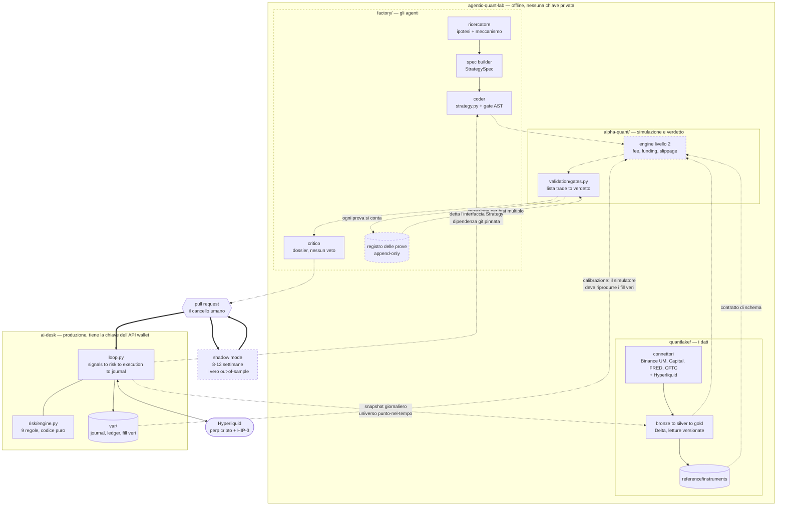

# Architettura del laboratorio

Tre repository, una sola direzione di dipendenza. Gli agenti progettano e scrivono
le strategie; quello che arriva in produzione resta una funzione Python
deterministica, e il rischio resta codice che nessun prompt può cambiare.

Tratteggiato = da costruire.

## Perché i confini cadono qui

**Il desk non dipende da nessuno.** È il sistema che tiene i soldi: gira con il
minimo installato e non importa niente dal laboratorio. La freccia va sempre
`laboratorio → desk`, mai al contrario, e tutto ciò che parla con un LLM sta dalla
parte che dipende. Conseguenza: il codice generato da un modello non si trova
nemmeno nello stesso repository della chiave privata, e ci arriva solo attraverso
un merge umano.

**Il verdetto è codice, il dossier è dell'LLM.** Tutto ciò che un modello può
rilevare leggendo un report di metriche — decadimento fuori campione, dipendenza da
un singolo trade, sensibilità a parametri e costi — è calcolabile. Se è un numero si
confronta con una soglia; il critico scrive perché a quel risultato non dovresti
credere, e non ha autorità di promuovere niente.

**Ogni prova si conta.** Il registro è append-only e tiene ogni ipotesi mai nata con
l'hash della sua spec e la versione dei dati. Senza un conteggio permanente dei
tentativi non esiste correzione per test multiplo, e il caveau out-of-sample non è
difendibile: niente impedirebbe di riproporre fra due settimane un'ipotesi già
bruciata con parole diverse.

**Il cancello è limitato dal calendario, non dal calcolo.** Lo storico serve a
scartare le ipotesi morte; la promozione la decide il tempo in avanti, perché è
l'unico campione su cui nessuno può sbirciare. Per questo la capacità produttiva
della fabbrica è irrilevante e può girare lenta.

**Il desk produce i dati, il laboratorio li consuma.** Un solo client Hyperliquid,
quello che opera davvero: se il simulatore leggesse le barre per una strada diversa
da quella del desk, la divergenza fra simulato e reale sarebbe garantita e
introvabile. Per lo stesso motivo il simulatore va calibrato contro `var/`, cioè
contro fill, slippage e fee di cicli realmente eseguiti: se non riproduce il passato
che abbiamo tradato, la sua opinione su una strategia mai tradata non vale niente.
