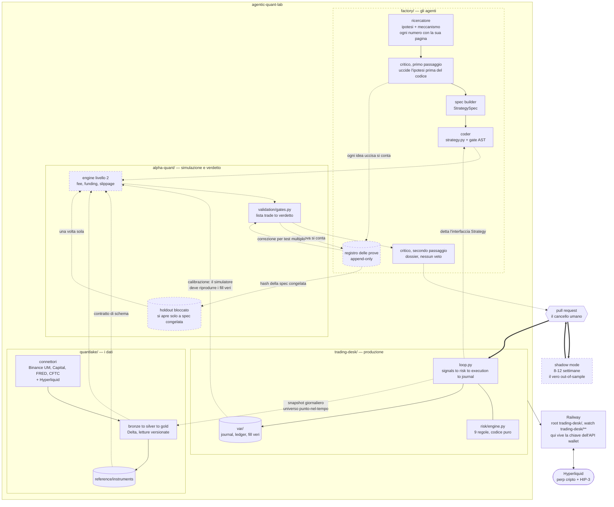

# Architettura del laboratorio

Un repository, tre pacchetti, una sola direzione di dipendenza. Gli agenti
progettano e scrivono le strategie; quello che arriva in produzione resta una
funzione Python deterministica, e il rischio resta codice che nessun prompt può
cambiare.

Tratteggiato = da costruire.

## Perché i confini cadono qui

**Un repo perché writer e reader di un contratto si cambiano insieme.**
`reference/instruments` è scritto da quantlake e letto in sola lettura da
alpha-quant; l'interfaccia `Strategy` è dettata da trading-desk e scritta dal coder.
In entrambi i casi lo schema non può cambiare senza il suo lettore, e in un repo
solo cambiano nello stesso commit con una sola esecuzione dei test. Una strategia
generata viene validata contro il codice del desk che la farà girare davvero, non
contro una dipendenza pinnata che può essere vecchia di una settimana.

**La direzione delle dipendenze è una regola, non un muro.** `trading-desk/` non importa
niente da `factory/`, da `alpha-quant/` o da `quantlake/`: è il sistema che tiene i
soldi e deve poter girare con il minimo installato. Separare i repo lo garantiva per
costruzione; qui va imposto da un test sui confini di import, come il desk già fa
al suo interno. La chiave dell'API wallet non sta in nessun repository: vive nelle
variabili di Railway e in `.env`, che è gitignorato.

**Il verdetto è codice, il dossier è dell'LLM.** Tutto ciò che un modello può
rilevare leggendo un report di metriche — decadimento fuori campione, dipendenza da
un singolo trade, sensibilità a parametri e costi — è calcolabile. Se è un numero si
confronta con una soglia; il critico scrive perché a quel risultato non dovresti
credere, e non ha autorità di promuovere niente.

**Ogni prova si conta.** Il registro è append-only e tiene ogni ipotesi mai nata con
l'hash della sua spec e la versione dei dati. Senza un conteggio permanente dei
tentativi non esiste correzione per test multiplo, e il caveau out-of-sample non è
difendibile: niente impedirebbe di riproporre fra due settimane un'ipotesi già
bruciata con parole diverse.

**Il cancello è limitato dal calendario, non dal calcolo.** Lo storico serve a
scartare le ipotesi morte; la promozione la decide il tempo in avanti, perché è
l'unico campione su cui nessuno può sbirciare. Per questo la capacità produttiva
della fabbrica è irrilevante e può girare lenta.

**Il desk produce i dati, il laboratorio li consuma.** Un solo client Hyperliquid,
quello che opera davvero: se il simulatore leggesse le barre per una strada diversa
da quella del desk, la divergenza fra simulato e reale sarebbe garantita e
introvabile. Per lo stesso motivo il simulatore va calibrato contro `var/`, cioè
contro fill, slippage e fee di cicli realmente eseguiti: se non riproduce il passato
che abbiamo tradato, la sua opinione su una strategia mai tradata non vale niente.

**Il caveau si chiude col codice, non col prompt.** Il loader di alpha-quant rifiuta le
date di holdout finché la spec non è congelata, cioè registrata con il suo hash. Nessun
agente può aprirlo prima, nemmeno se glielo chiedi: un divieto scritto in un prompt è una
richiesta cortese, un divieto nel loader è un muro.

**Il critico passa due volte.** La prima sull'ipotesi scritta, prima che esista una riga
di codice: è il punto in cui scartare non costa niente e non consuma dati. La seconda sul
risultato, per il dossier. Anche le idee uccise al primo passaggio entrano nel registro.

**Ogni numero preso da un paper porta la pagina.** `SourceRef` ha `page` obbligatorio: se il
ricercatore cita un effetto, si deve poter aprire il paper e trovarlo. È la difesa contro un
modello che attribuisce a un autore cose che l'autore non ha scritto.

## Il percorso verso il live

Il laboratorio esiste per un conto live futuro, ed è l'unico percorso che segue:

1. **validation** (aprile-dicembre 2025): il ciclo del desk rigiocato, giudicato con `k`
   dal registro. Una bocciatura chiude l'idea.
2. **holdout** (2026): un solo sguardo, deciso da una persona. Lo Sharpe deve restare
   almeno a metà di quello di validation.
3. **shadow**: la strategia gira ogni giorno nel desk, in un conto paper suo, su dati
   che nessuno ha visto. È l'unico out-of-sample che non si può sbirciare.
4. **live**: `mode: active` in `strategies.yaml`, con una pull request.

Fra 3 e 4 manca ancora un cancello scritto in codice: oggi il passaggio a live è una
decisione umana sui numeri dello shadow.

## Come gira la fabbrica

Gli agenti sono subagent di Claude Code in `.claude/agents/`, diretti dalla skill
`/quant-factory`: ricercatore, critico (due passaggi), spec builder, coder. Le regole
dure sono codice nel pacchetto `factory/` e in alpha-quant:

| comando | cosa garantisce |
|---|---|
| `factory check` | spec valida (ogni fonte con la pagina), codice attraverso il controllo statico e uno smoke run in un processo separato, senza credenziali, con perp appena quotati |
| `factory freeze` | spec + hash del codice nel registro: da qui è una prova |
| `factory evaluate` | il ciclo del desk sui giorni di validation, giudicato con `k` dal registro; a schermo solo PASS/FAIL e i nomi dei controlli falliti |
| `factory holdout --yes` | l'unico sguardo all'holdout, deciso da una persona |
| `factory promote` | la strategia entra nel desk come shadow, via pull request |

Il muro informativo (il coder non vede mai le metriche) è una regola che gli agenti
seguono, non una sandbox: i file con i numeri sono leggibili. Il controllo statico del
codice è un linter, non una sandbox: per questo il codice generato gira solo nel
laboratorio finché una persona non fa il merge.

## multicharts dentro il laboratorio (dal 12/11/2026)

La catena MultiCharts sta in `multicharts/`, importata dal repository `my-codes` con la sua
storia (commit `25de898`, ramo `audit-e-gate-intervallo`). Fuori sono rimasti il materiale del
corso (`protocollo/`, `education/`) e i vecchi progetti Python.

1. **Tre skill, nomi diversi.** `/ricerca` con gli agenti `ricerca-*` porta un'idea fino al
   dossier ([desk_ricerca.md](desk_ricerca.md)); `/lab` con `lab-coder` e `lab-judge` la porta
   dalla SPEC al verdetto; `/quant-factory` con gli agenti `factory-*` è la fabbrica
   Hyperliquid, oggi ferma. Tutti in `.claude/` alla radice.
2. **`/lab` si lancia dalla radice**: `python3 multicharts/docs/lab.py ...` e
   `PYTHONPATH=multicharts python3 -m motore...`. I percorsi dentro `pipeline_status.json`
   restano relativi a `multicharts/`.
3. **Gli sha sono cambiati.** L'import ha riscritto la storia: `multicharts/docs/commit_map_unione.tsv`
   tiene la corrispondenza vecchio → nuovo, e `lab.py` la usa per le righe `registrata: <sha>`
   delle SPEC, che non sono state toccate.
4. **Stato ancora separato.** `pipeline_status.json` e il registro delle varianti sono di `/lab`;
   `alpha-quant/registry` è della fabbrica e, dal 12/11, tiene anche il conto delle idee del
   desk di ricerca (voci `idea`, `measure`, `killed`).
5. **Le tabelle ES/NQ di quantlake restano intatte**: `motore` le legge da `quantlake/data`
   di questo stesso repository.

## Il deploy

Railway costruisce da `trading-desk/` (Root Directory) e guarda solo `trading-desk/**`
(watch paths). Senza i watch path, un commit nella fabbrica farebbe ripartire il
servizio che opera: è lo stesso difetto che aveva il deploy da my-codes, dove un
commit su MultiCharts poteva ridistribuire il desk.
