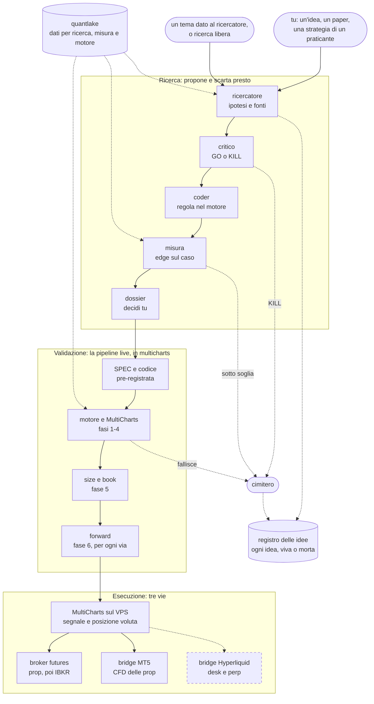

# Il laboratorio come desk di ricerca (12/11/2026)

**Stato: costruito il 12/11/2026, mai provato su un'idea vera.** Skill `/ricerca`, tre agenti,
misura, registro e perimetro ci sono e i test passano; manca il giro di prova in fondo. Segue l'[audit del 12/11](audit_2026-11-12.md) e la
decisione di Mario di portare le strategie in live con MultiCharts e la pipeline live di
multicharts (`pipeline_live.md`, ancora in bozza). L'esecuzione ha tre vie: broker futures, bridge
MT5 e, se si vuole, bridge verso il desk Hyperliquid.

**In una riga: questo repository smette di validare e di scegliere, e fa tre cose a monte di
`/lab`: propone ipotesi, le contesta sulle fonti, e misura l'edge in Python prima che esista una
riga di EasyLanguage.** Il verdetto resta a multicharts.

## Lo schema

Tratteggiato = opzionale.

- **Il segnale nasce in un posto solo**, MultiCharts. Le tre vie sono solo esecuzione.
- **Solo la prima via esegue lo strumento validato.** MT5 esegue un CFD e Hyperliquid un perp,
  con prezzo, costi e orari diversi, e sul perp il funding: il forward si rifà su ogni via.
- **Lo stesso segnale su tre conti è lo stesso rischio tre volte.** Il bilancio di rischio di
  `pipeline_live.md` si conta sulla somma delle vie.
- **Lo stop d'emergenza sta su ogni venue.** Nel bridge MT5 c'è; sul desk Hyperliquid oggi non
  viene piazzato (audit, sezione 2), e conta solo se si apre la terza via.

## Una correzione a quello che ho detto

Avevo scritto che nel tuo processo nessuno propone le idee. Non è vero: `prompt_ricerca_strategie.md`
descrive un ricercatore (`my-agents/researcher.py`, con `gate0.py` e un database delle fonti) e
dice com'è andata: **nove ricerche, zero candidate vive; dai paper zero su più di dieci; l'unica
viva su diciotto viene dai praticanti.** Il programma non è più su disco e non l'ho letto.

Quindi un agente che propone non basta: c'era già. Le cose che possono cambiare il risultato
sono altre quattro.

| # | cosa cambia | perché conta |
|---|---|---|
| 1 | **Lo spazio di ricerca.** La pipeline prop vuole intraday, flat a fine giornata, 2 segnali al giorno. `come_scegliere_un_paper.md` lo dice: «la letteratura solida è quasi tutta giornaliera o mensile», quindi lo spazio utile era stretto. La pipeline live toglie quei vincoli | è la differenza più grande, e non dipende dagli agenti |
| 2 | **La misura prima del codice.** L'eccesso sul caso oggi si misura con un indicatore EasyLanguage per idea, e tre volte su tre il bug era nell'indicatore | una funzione sola, testata, sugli stessi dati di `motore` |
| 3 | **Un critico separato che apre le fonti.** `gate0.py` ricalcola i filtri; non apre il paper alla pagina citata | è la difesa contro un ricercatore che attribuisce a un autore quello che non ha scritto |
| 4 | **Un conto solo di tutte le idee.** `pipeline_live.md` chiede un t sopra il massimo atteso per il numero totale di idee del programma (20 → 1,9 · 50 → 2,25) | quel numero oggi non lo tiene nessuno |

## Il percorso di un'idea

| passo | chi | cosa | esce |
|---|---|---|---|
| 1 | `/ricerca` | nome, orizzonte e mercato dell'idea; cosa è già stato fatto (`lab.py cerca`) | cartella e voce `idea` nel registro, o un rifiuto se è fuori perimetro |
| 2 | `ricerca-ricercatore` | ipotesi falsificabile, meccanismo, chi perde, fonti con pagina, regola eseguibile, soglia della misura | `hypothesis.md` |
| 3 | `ricerca-critico` | riapre le fonti, applica i filtri eliminatori, fa il conto frequenza × edge contro i costi | `critique.md`: GO o KILL |
| 4 | `ricerca-coder` | scrive la regola come strategia Python del motore, senza vedere numeri | `multicharts/motore/strategie/<id>.py` |
| 5 | codice | la misura sull'in-sample, contata nel registro | `misura.json`, SOPRA o SOTTO SOGLIA |
| 6 | `/ricerca` | mette in fila ipotesi, critica e misura | `dossier.md` |
| 7 | tu | decidi se vale una SPEC | il dossier passa a `/lab` |

- **Si ferma dopo 3, 5 e 6.** Un KILL o una misura sotto soglia chiude l'idea, e resta nel
  registro.
- **La soglia della misura si scrive al passo 2**, prima di misurare. Non può stare sotto i
  minimi del perimetro; può essere più severa.
- **Il passo 4 è il costo che il primo disegno non contava.** La misura parte dai trade del
  motore, quindi ogni idea che passa il critico va scritta in Python. Non sono più «secondi»:
  è il lavoro di un agente, e se arriva a una SPEC `lab-coder` riparte da quel file.
- **Ricercatore, critico e coder non vedono mai una misura**, né la propria né quelle delle
  altre idee.
- **L'ordine dei commit è la prova**: ipotesi prima della critica, critica prima del codice,
  codice prima della misura.

## Il perimetro

Sta in [`ricerca/perimetro.yaml`](../ricerca/perimetro.yaml) e si cambia con un commit. Lo
leggono gli agenti e lo fa rispettare il codice.

| cosa | oggi | chi lo fa rispettare |
|---|---|---|
| Orizzonti | **intraday acceso**; daily e swing spenti | `ricerca idea` rifiuta un orizzonte spento |
| Vincoli dell'orizzonte | intraday: flat a fine giornata, almeno 1 segnale al giorno | il critico |
| Mercati | NQ ed ES (hanno lo storico a 1 minuto); GC, CL e BTC senza dati | `ricerca idea` rifiuta un mercato senza dati |
| Minimi della misura | eccesso ad almeno 3 errori standard, almeno $10 al giorno per micro | `ricerca measure` stampa SOPRA o SOTTO SOGLIA |
| Tetto mensile | 8 idee nuove alla misura, dalle due porte insieme | `ricerca measure` rifiuta la nona |

- **Per accendere daily o swing non basta cambiare `attivo`.** Serve anche una misura per
  quell'orizzonte (`misura:` nel file): oggi il motore legge barre a 1 minuto di una sessione,
  e non c'è uno storico giornaliero su molti mercati. Con l'orizzonte acceso e la misura
  mancante, `ricerca idea` rifiuta lo stesso.
- **Un perimetro cambiato vale per le idee nuove.** Quelle già nel registro restano con
  l'orizzonte e il mercato del loro giorno.

## Le due porte

| | parte da | cosa fa il ricercatore |
|---|---|---|
| **Tu** | un'osservazione, un paper, una strategia di un praticante | la mette in forma: ipotesi falsificabile, meccanismo, chi perde, fonti con pagina, cosa la ucciderebbe |
| **Il ricercatore** | un tema che gli dai, o una ricerca libera nella letteratura | propone lui l'ipotesi, nella stessa forma |

Dal passo 2 in poi il percorso è identico.

- **Anche la tua idea passa dal critico e dalla misura.** Il critico non sa chi l'ha proposta.
- **Ogni idea entra nel registro appena nasce**, anche se muore dopo cinque minuti.
- **Il tetto mensile vale sulla somma** delle due porte.
- **Precedenza alle tue.** L'unica strategia viva su diciotto viene dai praticanti, e dalle nove
  ricerche automatiche nessuna. La ricerca libera serve soprattutto sullo spazio che la pipeline
  live apre: giornaliero e swing.
- **Una terza porta resta chiusa: la variante di un'idea morta.** È un'idea nuova, con il
  riferimento alla madre nel registro, e conta nel totale.

## Come si avvia un'idea

In una sessione Claude Code aperta in questo repository:

| cosa hai | cosa scrivi |
|---|---|
| un paper | `/ricerca nuova` e il PDF o il link |
| un'idea tua, o una strategia di un praticante | `/ricerca nuova` e l'idea con parole tue |
| un tema | `/ricerca tema flussi di fine mese sugli indici` |
| niente, vuoi una proposta | `/ricerca tema` |
| vuoi sapere a che punto sono le idee | `/ricerca stato` |

Il desk ti chiede nome, orizzonte e mercato, poi fa i passi 1-6 fermandosi dopo il critico,
dopo la misura e sul dossier.

- **Un paper può contenere più idee.** Il ricercatore scrive la migliore ed elenca le altre:
  ognuna, se la apri, è una cartella e una voce nel registro.
- **La regola eseguibile la scrive il ricercatore**, dalla fonte: cosa è un setup, quando si
  entra, stop, target, uscita a tempo. Senza parametri liberi. È il punto in cui un'idea vaga
  diventa falsificabile o muore.
- **Se il comando rifiuta**, l'idea non esiste: fuori perimetro, o tetto mensile raggiunto.

## Il dossier

È la fase 0 di `pipeline_live.md` («perché dovrebbe esistere, e continuare?») già compilata.

| sezione | chi la scrive |
|---|---|
| Ipotesi, meccanismo, chi perde e perché non smette | ricercatore |
| Fonti: autore, anno, rivista, pagina, cosa dice | ricercatore, verificate dal critico |
| I filtri di `come_scegliere_un_paper.md`, uno per riga, con sì / no / non stabilito | critico |
| Cosa la ucciderebbe, e la soglia della misura | ricercatore, prima della misura |
| Misura: eccesso sul caso, setup al giorno, dollari al giorno per micro, periodo, dati usati | codice |
| I due punti più deboli che la SPEC deve guardare | critico |

## La misura preliminare

- **Cosa misura.** Win rate osservato meno win rate di un random walk con la stessa geometria
  realizzata, più frequenza e dollari al giorno per micro. È il metro di
  `cosa_uccide_le_strategie.md`: non dipende dal rapporto target/stop.
- **Si calcola dai trade del motore**, non da un indicatore: stop e target risolti sul percorso
  a 1 minuto, ogni trade conta, R:R realizzato al netto dei costi. I tre bug degli indicatori
  di misura qui non hanno dove stare.
- **Calibrata su DriftPullback**, in-sample 2020-2024: WR 63,55% (SPEC 63,5%), R:R 0,641
  (0,640), caso 60,92% (61,0%), eccesso +2,62 punti (+2,6), t 3,03 (3,01). È un test
  (`multicharts/motore/test_misura.py`). VWAP Fade e ON Reversal non sono calibrabili: non
  sono nel motore, e ON Reversal era su YM, che nel lake non c'è.
- **Solo in-sample.** Il comando non ha un'opzione per altri periodi: mai la riserva di
  `pipeline_live.md` né l'out-of-sample 2025-2026.
- **Ogni misura conta.** È uno sguardo ai dati: entra nel registro e nel totale delle idee.
- **Non autorizza una strategia**: «un indicatore di misura al massimo la propone».

Dati che ci sono oggi nel lake:

| per cosa | cosa c'è | cosa manca |
|---|---|---|
| Intraday su indici | ES e NQ a 1 minuto, fino all'08/10/2026 | GC e CL (in `motore` sono «da fare») |
| Contesto | COT, VIX, catena opzioni SPX, GEX, calendario utili | |
| Cripto | BTCUSDT a 1 minuto dal 2019, perp Hyperliquid giornalieri, funding orario | intraday Hyperliquid oltre 208 giorni |
| Giornaliero su molti futures | solo ES e NQ | **tutto il resto**: senza, la letteratura giornaliera non è misurabile |

L'ultima riga è il lavoro sui dati che questa proposta richiede davvero.

## Dove sta ogni pezzo

| pezzo | dove | stato |
|---|---|---|
| Skill del desk di ricerca | `.claude/skills/ricerca/` | nuova |
| Ricercatore, critico, coder | `.claude/agents/ricerca-*.md` | nuovi |
| Perimetro | `ricerca/perimetro.yaml`, `ricerca/src/ricerca/perimetro.py` | nuovo |
| Comandi `idea`, `measure`, `kill` | `ricerca/src/ricerca/cli.py` | nuovi |
| Voci `idea`, `measure`, `killed` | `ricerca/src/ricerca/registry.py` | nuove |
| Misura | `multicharts/motore/misura.py` | nuova |
| `quantlake/` | | resta, ed è il centro. Serve un backup (punto 3 della scaletta) |
| `alpha-quant/`, `/quant-factory`, agenti `factory-*` | | tolti il 12/11/2026: la fabbrica Hyperliquid è chiusa. Restano nella storia di git, fino al commit `7cc21f9` |
| `trading-desk/` | | resta, fermo: sarà l'esecutore del bridge MultiCharts → Hyperliquid. Le cinque correzioni dell'audit si fanno prima di aprire quella via |

## Il confine con `/lab`

Dal 12/11/2026 multicharts sta in questo repository, in `multicharts/`.

- **Passa un file solo**: il dossier, che va in `multicharts/strategies/<X>/`.
- **Il desk di ricerca non scrive `pipeline_status.json` e non lancia `lab.py`**: da lì in poi
  lavora `/lab`.
- **Il conto totale delle idee** sta nel registro. Come arriva a `lab.py` è una decisione aperta.

## Cosa non aspettarsi

- **La maggior parte delle idee morirà comunque.** Cambia dove: ai passi 3 e 4, in minuti.
- **Il risultato dipende più dal punto 1 che dagli agenti.** Se la ricerca resta su intraday
  con flat a fine giornata, lo spazio è quello di prima e le nove ricerche a zero dicono
  cosa aspettarsi.
- **Più idee alzano la soglia per tutte.** Con 50 idee misurate il t richiesto in fase 2 è
  2,25 contro 1,9 con 20. Un desk che ne propone dieci a settimana consuma quel margine in un mese.
- **Autonomo fino al dossier.** Dopo, il tempo è quello di MultiCharts, tranne per le famiglie
  su cui `motore` è calibrato.

## Da decidere (Mario)

| | oggi | alternativa |
|---|---|---|
| Quando accendere daily e swing | spenti: prima serve uno storico giornaliero e una misura per quell'orizzonte | |
| Mercati | NQ ed ES | esportare GC e CL da MultiCharts (in `motore` sono «da fare»); BTC da Binance |
| Tetto mensile | 8 | un altro numero in `perimetro.yaml` |
| Chi tiene il conto totale delle idee per la soglia t di `pipeline_live.md` | il registro di qui (`ricerca status`), letto a mano quando `/lab` scrive la SPEC | un conto in `lab.py` |
| Le idee dei praticanti | alla pari dei paper | solo paper |

## Cosa manca

1. **Il giro di prova.** Tre idee già morte (per esempio VWAP Fade, ON Reversal, NQ First5) e
   DriftPullback, rifatte da zero con `/ricerca`: critico e misura devono uccidere le prime e
   lasciare viva la quarta. Se non distingue quelle quattro, l'impianto non serve. Consuma
   quattro degli otto posti del mese.
2. **La misura per daily e swing**, il giorno in cui si accendono.
3. **Il conto delle idee dentro `lab.py`**, se si decide di non leggerlo a mano.
