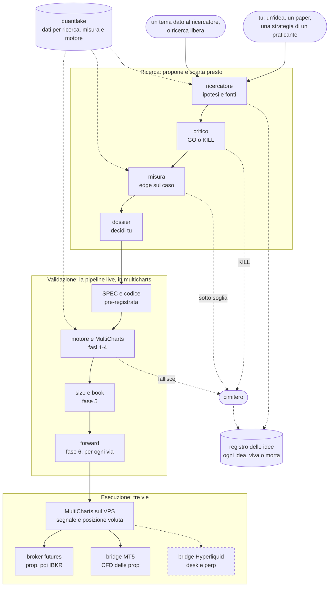

# Il laboratorio come desk di ricerca: proposta (12/11/2026)

**Stato: proposta, niente è in vigore.** Segue l'[audit del 12/11](audit_2026-11-12.md) e la
decisione di Mario di portare le strategie in live con MultiCharts e la pipeline live di
multicharts (`pipeline_live.md`, ancora in bozza). L'esecuzione ha tre vie: broker futures, bridge
MT5 e, se si vuole, bridge verso il desk Hyperliquid.

**In una riga: questo repository smette di validare e di scegliere, e fa tre cose a monte di
`/lab`: propone ipotesi, le contesta sulle fonti, e misura l'edge in Python prima che esista una
riga di EasyLanguage.** Il verdetto resta a multicharts.

## Lo schema

Tratteggiato = opzionale.

- **Il segnale nasce in un posto solo**, MultiCharts. Le tre vie sono solo esecuzione.
- **Solo la prima via esegue lo strumento validato.** MT5 esegue un CFD e Hyperliquid un perp,
  con prezzo, costi e orari diversi, e sul perp il funding: il forward si rifà su ogni via.
- **Lo stesso segnale su tre conti è lo stesso rischio tre volte.** Il bilancio di rischio di
  `pipeline_live.md` si conta sulla somma delle vie.
- **Lo stop d'emergenza sta su ogni venue.** Nel bridge MT5 c'è; sul desk Hyperliquid oggi non
  viene piazzato (audit, sezione 2), e conta solo se si apre la terza via.

## Una correzione a quello che ho detto

Avevo scritto che nel tuo processo nessuno propone le idee. Non è vero: `prompt_ricerca_strategie.md`
descrive un ricercatore (`my-agents/researcher.py`, con `gate0.py` e un database delle fonti) e
dice com'è andata: **nove ricerche, zero candidate vive; dai paper zero su più di dieci; l'unica
viva su diciotto viene dai praticanti.** Il programma non è più su disco e non l'ho letto.

Quindi un agente che propone non basta: c'era già. Le cose che possono cambiare il risultato
sono altre quattro.

| # | cosa cambia | perché conta |
|---|---|---|
| 1 | **Lo spazio di ricerca.** La pipeline prop vuole intraday, flat a fine giornata, 2 segnali al giorno. `come_scegliere_un_paper.md` lo dice: «la letteratura solida è quasi tutta giornaliera o mensile», quindi lo spazio utile era stretto. La pipeline live toglie quei vincoli | è la differenza più grande, e non dipende dagli agenti |
| 2 | **La misura prima del codice.** L'eccesso sul caso oggi si misura con un indicatore EasyLanguage per idea, e tre volte su tre il bug era nell'indicatore | una funzione sola, testata, sugli stessi dati di `motore` |
| 3 | **Un critico separato che apre le fonti.** `gate0.py` ricalcola i filtri; non apre il paper alla pagina citata | è la difesa contro un ricercatore che attribuisce a un autore quello che non ha scritto |
| 4 | **Un conto solo di tutte le idee.** `pipeline_live.md` chiede un t sopra il massimo atteso per il numero totale di idee del programma (20 → 1,9 · 50 → 2,25) | quel numero oggi non lo tiene nessuno |

## Il percorso di un'idea

| passo | chi | cosa | esce | quanto costa |
|---|---|---|---|---|
| 1 | tu, o il ricercatore su un tema (le due porte, sotto) | un'osservazione, un paper, una strategia di un praticante | una riga nel registro: l'idea esiste | minuti |
| 2 | `factory-researcher` | ipotesi falsificabile, meccanismo, chi perde, fonti con pagina, cosa la ucciderebbe | `hypothesis.md` | minuti |
| 3 | `factory-critic` | apre le fonti, applica i filtri eliminatori, fa il conto frequenza × edge contro i costi | `critique.md`: GO o KILL | minuti |
| 4 | codice, non un agente | la misura preliminare sull'in-sample: eccesso sul caso, numero di setup, intervallo | `misura.json` | secondi |
| 5 | tu | leggi il dossier e decidi se vale una SPEC | il dossier passa a multicharts | |
| 6 | `/lab` in multicharts | SPEC pre-registrata, codice, fasi 1-7 | verdetto, come oggi | giorni |

- **Si ferma dopo 3 e dopo 4.** Un KILL o una misura sotto soglia chiude l'idea, e resta nel
  registro.
- **La soglia della misura si scrive al passo 2**, prima di misurare, come soglia, attesa e kill
  nella SPEC.
- **Il ricercatore e il critico non vedono le misure delle altre idee**, come oggi non vedono i
  verdetti.

## Le due porte

| | parte da | cosa fa il ricercatore |
|---|---|---|
| **Tu** | un'osservazione, un paper, una strategia di un praticante | la mette in forma: ipotesi falsificabile, meccanismo, chi perde, fonti con pagina, cosa la ucciderebbe |
| **Il ricercatore** | un tema che gli dai, o una ricerca libera nella letteratura | propone lui l'ipotesi, nella stessa forma |

Dal passo 2 in poi il percorso è identico.

- **Anche la tua idea passa dal critico e dalla misura.** Il critico non sa chi l'ha proposta.
- **Ogni idea entra nel registro appena nasce**, anche se muore dopo cinque minuti.
- **Il tetto mensile vale sulla somma** delle due porte.
- **Precedenza alle tue.** L'unica strategia viva su diciotto viene dai praticanti, e dalle nove
  ricerche automatiche nessuna. La ricerca libera serve soprattutto sullo spazio che la pipeline
  live apre: giornaliero e swing.
- **Una terza porta resta chiusa: la variante di un'idea morta.** È un'idea nuova, con il
  riferimento alla madre nel registro, e conta nel totale.

## Come si avvia un'idea

**Oggi non si può ancora:** servono i punti 1-4 dell'ordine dei lavori in fondo. Quando ci sono,
un'idea parte così, dentro una sessione Claude Code in questo repository.

Partendo da un paper:

| | chi | cosa succede |
|---|---|---|
| 1 | tu | apri la skill e dai il paper (il PDF o il link) e un nome per l'idea |
| 2 | skill | crea la cartella dell'idea, ci salva il paper e scrive la voce `idea` nel registro |
| 3 | ricercatore | legge il paper e scrive `hypothesis.md`: ogni numero con la sua pagina, e la soglia della misura |
| 4 | critico | riapre il paper alle pagine citate, applica i filtri, fa il conto frequenza × edge. Scrive GO o KILL |
| 5 | skill | **si ferma e ti dice l'esito.** Con KILL l'idea è chiusa e registrata |
| 6 | codice | con GO gira la misura sull'in-sample e la confronta con la soglia scritta al passo 3 |
| 7 | skill | **si ferma e ti mostra il dossier.** Sotto soglia l'idea è chiusa |
| 8 | tu | decidi se vale una SPEC. Se sì, il dossier va in `multicharts/strategies/<X>/` e parte `/lab` |

- **Senza paper** (una tua osservazione, o un tema): cambia solo il passo 1. Il ricercatore
  cerca lui le fonti; se non ne trova lo scrive, e il critico decide se il meccanismo regge da solo.
- **Un paper può contenere più idee.** Ognuna è una cartella e una voce nel registro.
- **La misura ha bisogno di una regola eseguibile**: cosa è un setup, quando si entra, dove
  stanno stop e target. Se il paper non la dà, la scrive il ricercatore nell'ipotesi, prima della
  misura; è il punto in cui un'idea vaga diventa falsificabile o muore.
- **Tempo atteso:** minuti fino al passo 7, se i dati ci sono già nel lake.

## Il dossier

È la fase 0 di `pipeline_live.md` («perché dovrebbe esistere, e continuare?») già compilata.

| sezione | chi la scrive |
|---|---|
| Ipotesi, meccanismo, chi perde e perché non smette | ricercatore |
| Fonti: autore, anno, rivista, pagina, cosa dice | ricercatore, verificate dal critico |
| I filtri di `come_scegliere_un_paper.md`, uno per riga, con sì / no / non stabilito | critico |
| Cosa la ucciderebbe, e la soglia della misura | ricercatore, prima della misura |
| Misura: eccesso sul caso, setup al giorno, dollari al giorno per micro, periodo, dati usati | codice |
| I due punti più deboli che la SPEC deve guardare | critico |

## La misura preliminare

- **Cosa misura.** Win rate osservato meno win rate di un random walk con la stessa geometria
  realizzata, più frequenza e dollari al giorno per micro. È il metro di
  `cosa_uccide_le_strategie.md`: non dipende dal rapporto target/stop.
- **Prima va calibrata**, come `motore`: deve ritrovare tre numeri già noti, DriftPullback +2,8
  punti, VWAP Fade −0,62, ON Reversal +0,68. Finché non li ritrova non si usa.
- **Solo in-sample.** Mai la riserva di `pipeline_live.md` né l'out-of-sample 2025-2026.
- **Ogni misura conta.** È uno sguardo ai dati: entra nel registro e nel totale delle idee.
- **Non autorizza una strategia**: «un indicatore di misura al massimo la propone».

Dati che ci sono oggi nel lake:

| per cosa | cosa c'è | cosa manca |
|---|---|---|
| Intraday su indici | ES e NQ a 1 minuto, fino all'08/10/2026 | GC e CL (in `motore` sono «da fare») |
| Contesto | COT, VIX, catena opzioni SPX, GEX, calendario utili | |
| Cripto | BTCUSDT a 1 minuto dal 2019, perp Hyperliquid giornalieri, funding orario | intraday Hyperliquid oltre 208 giorni |
| Giornaliero su molti futures | solo ES e NQ | **tutto il resto**: senza, la letteratura giornaliera non è misurabile |

L'ultima riga è il lavoro sui dati che questa proposta richiede davvero.

## Cosa succede ai pezzi di questo repository

| pezzo | destino |
|---|---|
| `quantlake/` | resta, ed è il centro. Serve un backup (punto 3 della scaletta) |
| `factory-researcher`, `factory-critic` (primo passaggio) | restano; cambiano mercato, vincoli e filtri nel prompt |
| `alpha-quant/registry` | resta, con due voci nuove: `idea` e `killed` |
| una libreria di misura, nuova | in `alpha-quant/`, con i suoi test |
| `factory-spec-builder`, `factory-coder`, `factory check/freeze/evaluate/holdout/promote` | fermi: SPEC e codice li scrive `/lab` |
| replay del desk, gate di portafoglio, `splits.yaml` | fermi. Restano validi per un'idea giornaliera su perp, se un giorno torna |
| `trading-desk/` | solo esecutore della terza via, opzionale. Le cinque correzioni dell'audit si fanno prima di aprirla, non prima |

## Il confine con `/lab`

Dal 12/11/2026 multicharts sta in questo repository, in `multicharts/`.

- **Passa un file solo**: il dossier, che va in `multicharts/strategies/<X>/`.
- **Il desk di ricerca non scrive `pipeline_status.json` e non lancia `lab.py`**: da lì in poi
  lavora `/lab`.
- **Il conto totale delle idee** sta nel registro. Come arriva a `lab.py` è una decisione aperta.

## Cosa non aspettarsi

- **La maggior parte delle idee morirà comunque.** Cambia dove: ai passi 3 e 4, in minuti.
- **Il risultato dipende più dal punto 1 che dagli agenti.** Se la ricerca resta su intraday
  con flat a fine giornata, lo spazio è quello di prima e le nove ricerche a zero dicono
  cosa aspettarsi.
- **Più idee alzano la soglia per tutte.** Con 50 idee misurate il t richiesto in fase 2 è
  2,25 contro 1,9 con 20. Un desk che ne propone dieci a settimana consuma quel margine in un mese.
- **Autonomo fino al dossier.** Dopo, il tempo è quello di MultiCharts, tranne per le famiglie
  su cui `motore` è calibrato.

## Da decidere (Mario)

| | proposta | alternativa |
|---|---|---|
| Perimetro della ricerca | anche giornaliero e swing, come permette `pipeline_live.md` | solo intraday, come oggi |
| Mercati | futures CME, più BTC ed ETH | solo gli strumenti di `motore` |
| Dati giornalieri su molti futures | una fonte nuova in quantlake, prima di cercare lì | restare su ES e NQ |
| Quante idee al mese arrivano alla misura | un tetto, per esempio 8 | nessun tetto, e la soglia t sale |
| Chi tiene il conto totale delle idee | il registro di qui, letto a mano quando `/lab` scrive la SPEC | un conto in `lab.py` |
| Le idee dei praticanti | alla pari dei paper, con il filtro loro del 26/10 | solo paper |

## Ordine dei lavori

1. Libreria di misura e calibrazione sui tre numeri noti.
2. Voci `idea` e `killed` nel registro, e il comando che le scrive.
3. Nuovi prompt di ricercatore e critico: vincoli della pipeline live, filtri di
   `come_scegliere_un_paper.md`, formato del dossier.
4. Skill che dirige i passi 1-5 e si ferma al dossier.
5. Un primo giro su tre idee già morte e una viva: il critico e la misura devono uccidere le
   morte e lasciare DriftPullback.

Il punto 5 è il test dell'impianto: se non distingue quelle quattro, non serve.
